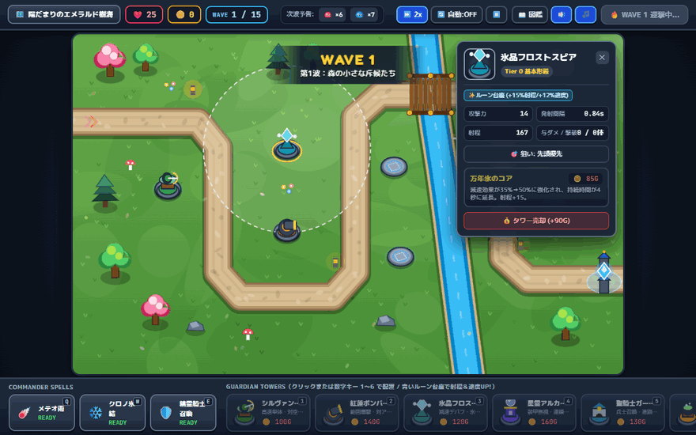
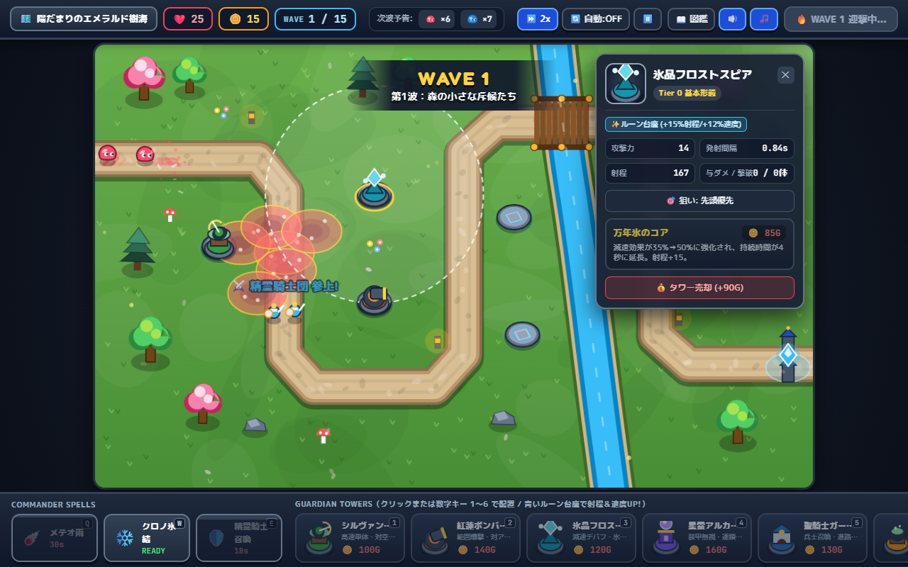
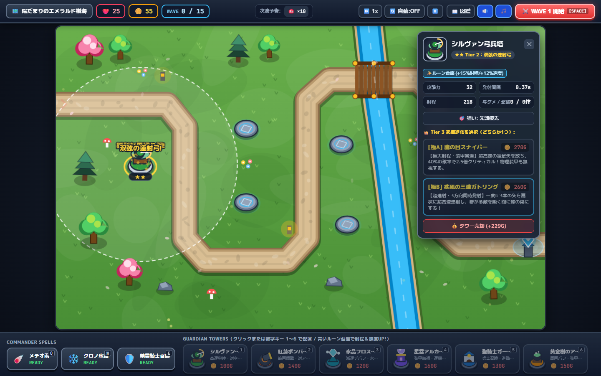
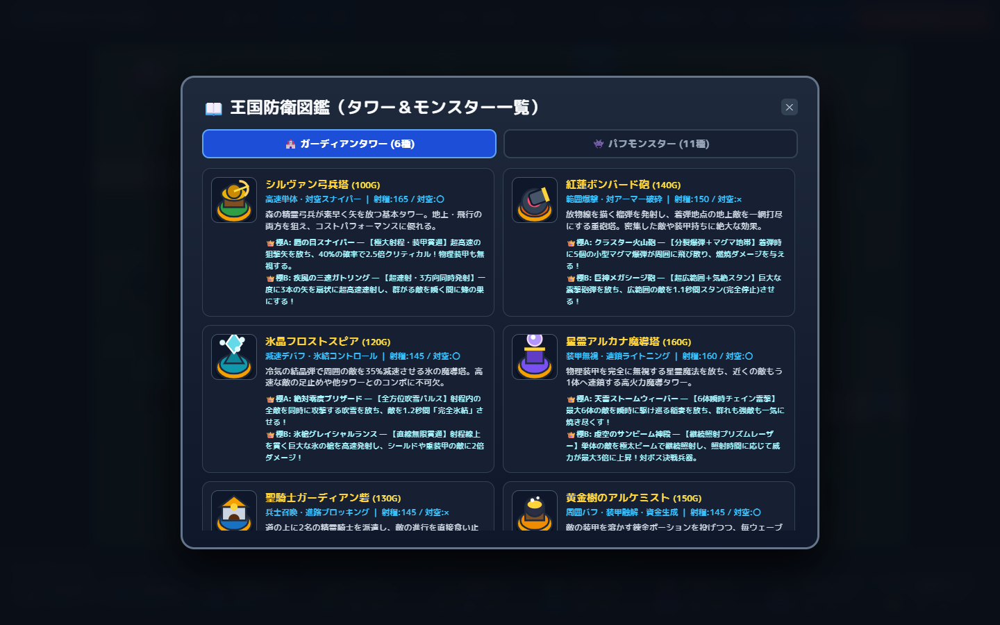
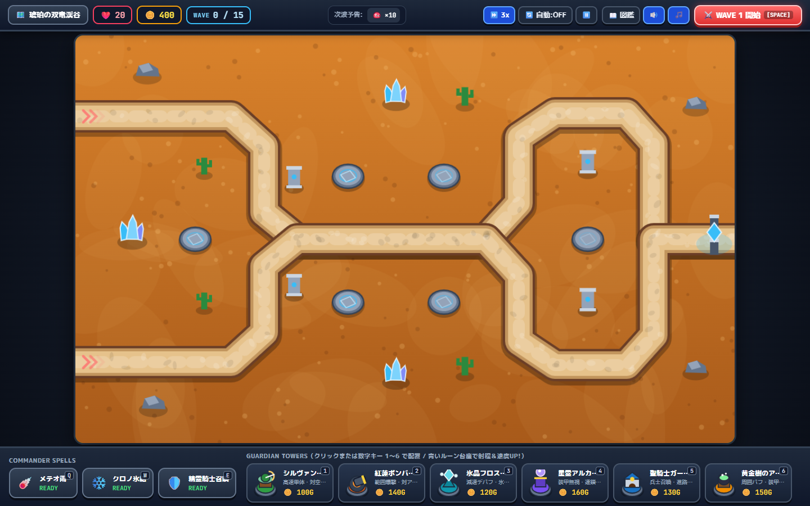
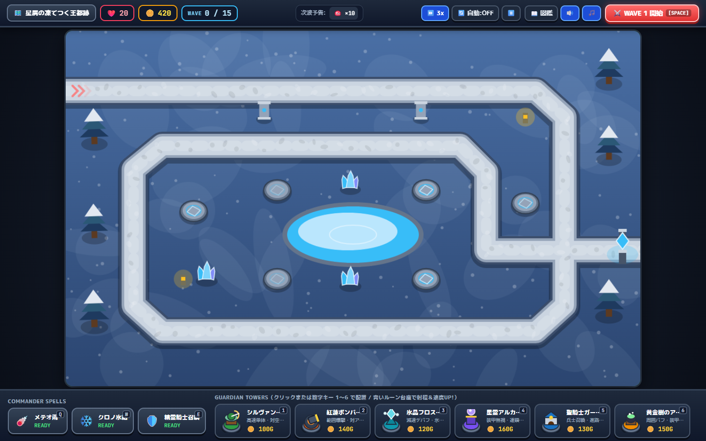

# 👑 POPCROWN TD ～精霊樹海とぷるぷるスライム防衛戦～

『Bloons TD 6』の爽快な多層ポップ感・分岐アップグレードと、『Kingdom Rush』の兵士ブロッキング・指揮官スペル・ファンタジー世界観を融合させた、ブラウザで快適に遊べる2.5Dタワーディフェンスゲームです。



---

## 📸 スクリーンショット・ギャラリー

### 1. タイトル＆ステージ選択画面（クリア星評価・最高到達WAVE保存対応）


### 2. 戦闘＆指揮官スペル（メテオストライク・精霊騎士召喚）


### 3. タワー詳細インスペクター＆Tier 3 究極分岐進化（極A / 極B）


### 4. 王国防衛図鑑（タワー＆モンスター一覧）


### 5. ステージ2「琥珀の双竜渓谷」＆ステージ3「星屑の凍てつく王都跡」
| 琥珀の双竜渓谷 (HARD / 2ルート合流) | 星屑の凍てつく王都跡 (EXPERT / 氷結湖回廊) |
| :---: | :---: |
|  |  |

---

## 🚀 起動方法

### 1. 開発サーバーで今すぐプレイする場合
```bash
npm install
npm run dev
```
ブラウザで **`http://localhost:5173`** を開くとすぐにプレイできます。

### 2. 本番ビルド＆プレビュー
```bash
npm run build
npm run preview
```

---

## 🎮 主な特徴・ゲームシステム

### 1. 3つの個性豊かなステージ
1. **陽だまりのエメラルド樹海 (NORMAL)** — 小川と木の橋を越えるS字の樹海ルート。
2. **琥珀の双竜渓谷 (HARD)** — 南北2つの侵攻ルートが中央の遺跡で合流する戦略マップ。
3. **星屑の凍てつく王都跡 (EXPERT)** — 凍てつく魔法湖の周囲を螺旋状に行進する上級者向けマップ。

### 2. 「精霊のルーン台座」システム
マップ上に点在する青い魔法陣（ルーン台座）の上にタワーを建設すると、自動的にスナップして**射程+15%・攻撃速度+12%**の恒久ボーナスを獲得します。

### 3. 6種類のガーディアンタワー＆Tier 3 究極分岐進化 (極A / 極B)
すべてのタワーは基本形態から2段階強化（Tier 1 → Tier 2）したのち、**Tier 3で2つの究極形態（極A または 極B）へ分岐進化**できます。

| キー | タワー名 | 役割・特徴 | 👑 極A 分岐進化 | 👑 極B 分岐進化 |
| :---: | :--- | :--- | :--- | :--- |
| `1` | **シルヴァン弓兵塔** | 高速単体・対空 | **鷹の目スナイパー**（超長射程・装甲無視・2.5倍クリティカル） | **疾風の三連ガトリング**（3方向扇状の超高速連射） |
| `2` | **紅蓮ボンバード砲** | 範囲爆撃・対装甲 | **クラスター火山砲**（着弾時に5個の小型マグマ爆弾に分裂＋炎上地帯） | **巨神メガシージ砲**（超広範囲の敵を1.1秒間スタン気絶） |
| `3` | **氷晶フロストスピア** | 減速・脆弱化デバフ | **絶対零度ブリザード**（射程内の全敵を同時攻撃＆周期的に完全氷結） | **氷槍グレイシャルランス**（直線12体貫通の氷槍・対シールド特効） |
| `4` | **星霊アルカナ魔導塔** | 装甲無視・連鎖雷撃 | **天雷ストームウィーバー**（最大6体の敵を瞬時に駆け巡る紫電） | **虚空のサンビーム神殿**（単体継続照射で威力が最大3倍に上昇するレーザー） |
| `5` | **聖騎士ガーディアン砦** | 兵士召喚・足止め | **聖堂パラディン騎士団**（自己回復＋周囲を薙ぎ払うホーリーストライク） | **天空の槍ヴァルキリー**（地上阻止＋飛行する敵へ雷槍を投擲） |
| `6` | **黄金樹のアルケミスト** | 周囲バフ・装甲融解・資金生成 | **黄金の豊穣神殿**（敵を黄金化し撃破金2倍＋毎波+100G生成） | **狂乱オーバードライブ工房**（周囲の塔の速度+35%/威力+25%＋3連フラスコ） |

### 4. 指揮官スペル（アクティブスキル）
- **`Q` メテオ雨（メテオストライク）**：指定地点に6発の隕石を降らせ、広範囲に大ダメージ＋溶岩エリアを生成。
- **`W` クロノ氷結（クロノ・サージ）**：画面内の全敵を氷結させ、6秒間すべての味方タワーの攻撃速度を+35%加速。
- **`E` 精霊騎士召喚**：指定した道の上に精鋭の精霊騎士2名を16秒間召喚し、敵をブロック＆迎撃。

### 5. 多層スライム＆個性的な敵モンスター（全11種）
- **レッド / ブルー / グリーン / イエロー・ターボ**：外皮を割ると中から下位スライムが飛び出す多層パフスライム！
- **マザー・ゼリー**：撃破時に高速なミニ・ゼリー3体へ分裂。
- **アイアン・シェル**：物理ダメージを55%軽減する重装甲ゴーレム。
- **クラウド・ワイバーン**：地上兵のブロックを無視して飛ぶ空挺モンスター。
- **ハニー・シャーマン**：周囲の敵のHPを周期的に回復するヒーラー。
- **クリスタル・ガーディアン**：魔力シールドと重装甲を併せ持つ精鋭。
- **大魔王グミ・ベヒーモス**：圧倒的なHPとシールドを持ち、撃破時にも内部から精鋭部隊が飛び出す巨大ボス！

---

## ⌨️ ショートカットキー操作一覧

- **`1` 〜 `6`**：タワーの選択
- **`Q` / `W` / `E`**：指揮官スペルの発動
- **`SPACE`**：ウェーブ開始 ／ 次ウェーブの早期開始（ボーナスゴールド獲得）
- **`R`**：選択中のガーディアン砦の集合地点（ラリーポイント）変更
- **`右クリック` / `ESC`**：配置・スペル照準のキャンセル、インスペクターを閉じる
